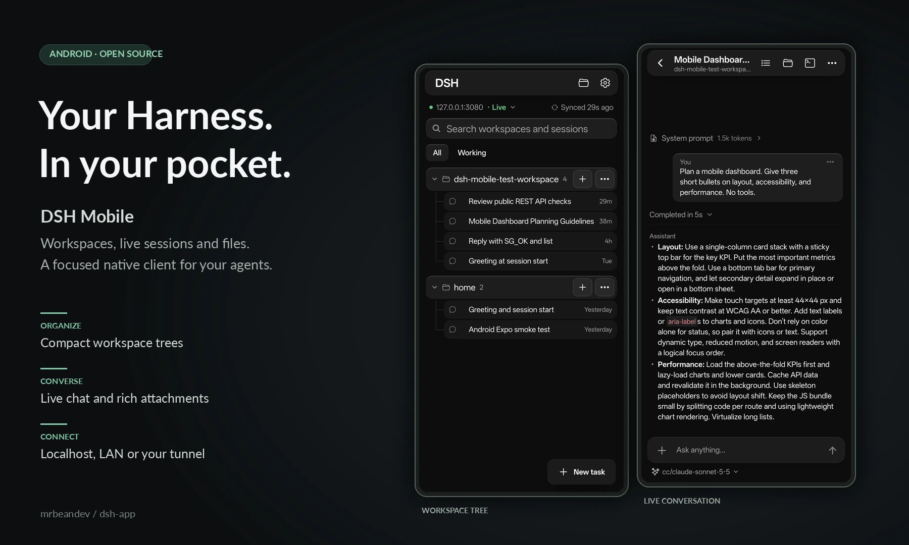
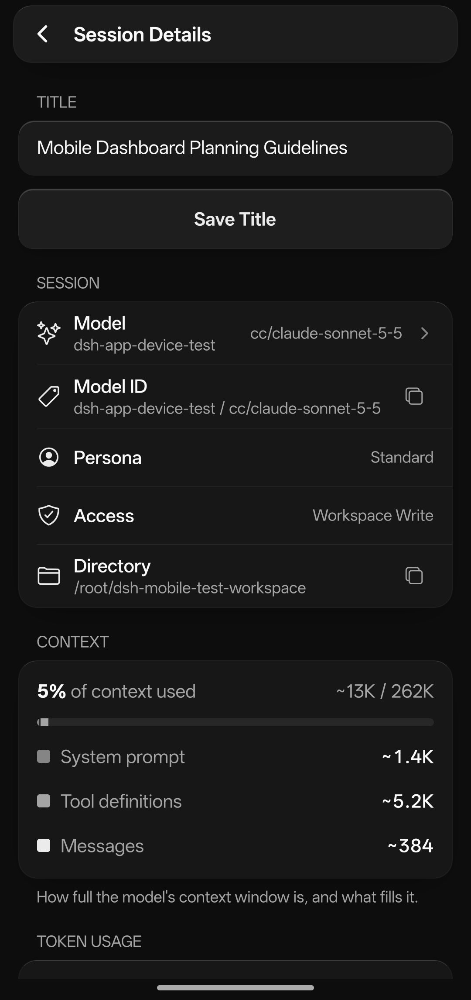
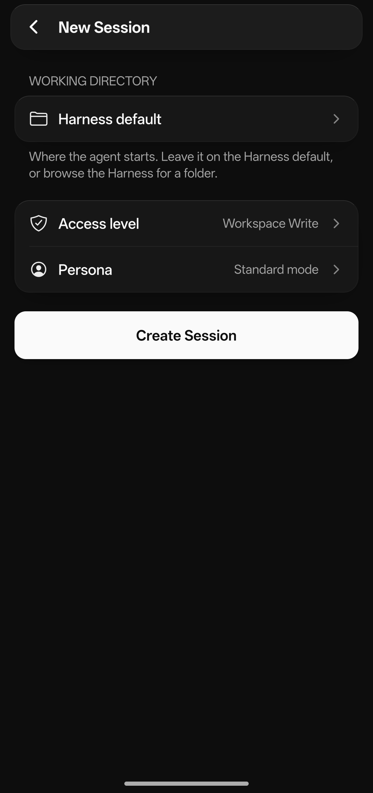
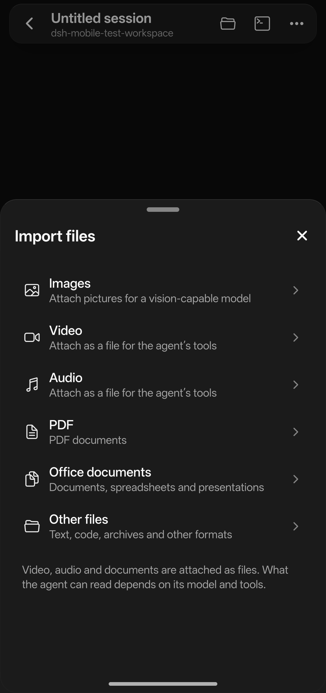

<p align="center"></p>

<h1 align="center">DSH Mobile</h1>

<p align="center">A mobile client for <a href="https://github.com/deepseek-ai">DeepSeek Harness</a> (DSH): chat with your agents, watch them work live, and manage workspaces, files and terminals from your phone.</p>

<p align="center">
  <a href="https://github.com/mrbeandev/dsh-app/releases/latest"></a>
  
  
  <a href="LICENSE"></a>
</p>

<p align="center">
  
</p>

<details>
<summary>More screens</summary>
<p align="center">
  
  
  
</p>
</details>

Real screenshots from the Android app with sample conversations on a test Harness (October 2026).

> Independent community project. Not affiliated with or endorsed by DeepSeek or T3.

## Install

1. Download the latest `.apk` from **[Releases](https://github.com/mrbeandev/dsh-app/releases/latest)** on your Android phone.
2. Open it and allow installing from your browser or file manager when Android asks.
3. Later versions install from inside the app: **Settings › App Updates**.

Android 7.0 (API 24) or newer. iOS is not released yet.

## Connect

Two fields, nothing else:

| Field | What to enter |
|---|---|
| **Harness URL** | Where `dsh web` is reachable: `http://127.0.0.1:3080` on the same phone (e.g. Termux), your computer's LAN address, or an HTTPS tunnel. |
| **Auth token** | The launch token `dsh web` prints when it starts. |

The app exchanges the token for a session cookie, exactly like the DSH Web UI. Tokens are stored in the device keystore. Use HTTPS for anything that leaves your network.

## Features

**Sessions and chat**
- Workspace tree sorted by last activity, live dot on working threads, pin and archive.
- Live streaming replies with Markdown, code blocks (copy), quotes and inline code.
- Tool calls, reasoning, context and compaction shown as compact rows; finished turns fold into *Completed in 4m 5s*.
- Approvals, questions and **plan review** (approve or keep planning with feedback).
- Goal and to-do strip above the composer (pause, resume, edit, clear).
- **Rewind to any earlier message** of yours and resend it (app feature; no Harness plugin needed).
- **Pinch** the chat with two fingers (or tap the list icon) to browse every prompt with its date and jump to it.
- Opens at the latest message; older history loads as you scroll up.

**Thread details** — model, persona and access mode; context usage, token usage (cache hit, input, output) and session statistics (turns, steps, LLM/tool time, TTFT, TPS); copy buttons for IDs and paths.

**Workspace tools**
- **Files** — sort by name, date or size; full-screen previews for images, PDFs, spreadsheets/CSV and text; download any file to your phone (byte-exact, any size), then open or share it.
- **Terminal** — a real terminal emulator (xterm.js): colours, full-screen programs like `top`/`vim`, a key bar (Ctrl, Esc, Tab, arrows) and adjustable font size.
- Add, rename and remove workspaces; new threads with access mode and persona.

**Built for mobile** — per-Harness cache (SQLite) for instant start and offline reading; only the open thread streams live. Native [Solid Glass](https://github.com/deeplethe/solid-glass) styling in light and dark.

**In-app updates** — checks GitHub Releases in the background, downloads the new APK with progress, and hands it to Android's installer. You confirm the install.

## Build from source

Requires Node.js 22+, npm, and for Android builds JDK 17+ and the Android SDK.

```sh
npm ci
npm start              # Metro dev server
npm run android        # debug build on a connected device
npm test               # unit tests (vitest)
npm run typecheck
npm run lint
```

`android/` and `ios/` are generated (Expo Continuous Native Generation); configure native behaviour in `app.json` and `plugins/`.

### Release builds

Release APKs are signed with a key that never lives in this repository. `plugins/withReleaseSigning.js` reads it from environment variables:

```sh
export DSH_RELEASE_STORE_FILE=/path/to/release.keystore
export DSH_RELEASE_STORE_PASSWORD=…
export DSH_RELEASE_KEY_ALIAS=…
export DSH_RELEASE_KEY_PASSWORD=…
npx expo prebuild --platform android --clean
cd android && ./gradlew assembleRelease
```

Without those variables a release build falls back to the debug key (fine for local testing, but it cannot update an installed official build). To ship a version, bump `version` and `android.versionCode` in `app.json`, then publish a GitHub release tagged `vX.Y.Z` with the APK attached; installed apps pick it up through the updater.

## Project layout

```
src/app/         screens (Expo Router): home, thread, details, files, terminal, settings…
src/components/  UI: glass surfaces, dialogs, loaders, chat rows, composer, sheets
src/lib/         Harness client (RPC + WebSocket mux), transcript builder, cache, updater
src/state/       connection, sessions/workspaces, updates
plugins/         Expo config plugins (release signing)
scripts/         make-icons.py — rebuilds every icon from one master image
```

The Harness is the source of truth. The app speaks the same public HTTP/WebSocket API as the DSH Web UI and never touches the Harness's files directly.

## Credits

This app was rebuilt with two open-source projects as references:

- **[T3 Code — mobile](https://github.com/pingdotgg/t3code/tree/main/apps/mobile)** by T3 Tools Inc. — UI and screen patterns.
- **[DeepSeek Harness Mobile](https://github.com/sorsama/deepseek-harness-mobile)** — functionality and Harness protocol reference.

Both are MIT licensed; their notices are kept in [THIRD_PARTY_NOTICES.md](THIRD_PARTY_NOTICES.md) and [`licenses/`](licenses).

## License

[MIT](LICENSE) © 2026 mrbeandev
